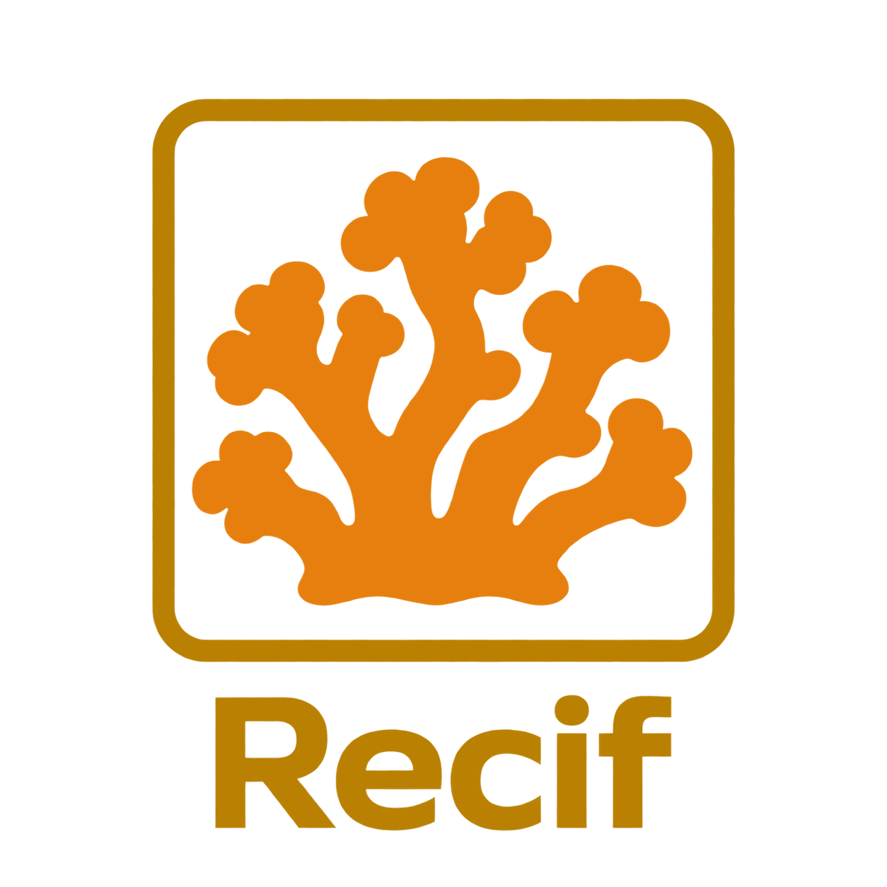
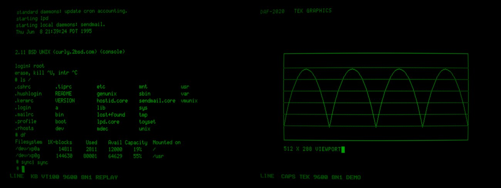

# Recif

[Română](README.ro.md)

<p align="center"></p>

An emulator of the Romanian 16-bit CORAL minicomputers and of the FEPER
DAF-2020 terminal, as two programs joined by a serial line. Recif is built
for Windows and Linux, on x64 and ARM64; the ARM64 builds have not been tried
on real ARM hardware (see the [compatibility notes](docs/NOTES.md#compatibility)).



## The machines

- `recif` is the computer: a control panel and a command-line tool. Select
  the CORAL 4001, 4011, 4021 or 4030 and configure RAM, the FP11
  floating-point processor, the serial port, the clock, tape media and disk
  packs.
- `daf2020` is the green-phosphor terminal, with its Tektronix 4010 and
  VT100 personalities.

The CORAL profiles include documented hardware inventories and run on
explicitly identified DEC compatibility cores. See the
[model evidence and coverage](docs/NOTES.md#coral-models). The release
archives include a ready-to-boot [2.11BSD pack](docs/NOTES.md#211bsd).

## Quick start

1. Extract the archive: `Recif-<version>-windows-x64.zip` or
   `-windows-arm64.zip`, or `Recif-<version>-linux-x64.tar.gz` or
   `-linux-arm64.tar.gz`.
2. Run `recif.exe` and `daf2020.exe` (Windows) or `./recif` and `./daf2020`
   (Linux) from the extracted folder.
3. Press **Start reference** in Recif: the CORAL 4021 boots 2.11BSD and the
   terminal shows its `:` prompt. Press Enter there and follow the
   [2.11BSD notes](docs/NOTES.md#211bsd).

The folder holds the two programs, `disks/` (the 2.11BSD pack) and `docs/`.
Both programs remember their settings in `recif.yaml` and `daf2020.yaml`
beside the programs.

On Linux the programs need a 64-bit system with glibc 2.34 or later and the
libraries of the desktop SDL talks to: X11 or Wayland, OpenGL or OpenGL ES,
and ALSA or PulseAudio for the terminal's sound. The Linux panel is worked
with the mouse or the keyboard: Up and Down choose a row, Enter changes it.

The two programs can also be started from the command line. The examples in
the notes are written for PowerShell; on Linux the programs are `./recif`
and `./daf2020` and paths use `/`.

```powershell
.\recif.exe run --model 4030 --serial tcp-listen:2323
.\daf2020.exe --serial tcp:127.0.0.1:2323
```

`recif --help` lists the tape conversion, Files-11 extraction, disk restore
and other command-line options.

## Keys

In the terminal:

| Key | |
|---|---|
| F12 | Open and close the settings: language, mode, serial connection, the 14 keyboard switches, the CRT effect, an inverted screen and a restart |
| Ctrl+F12 | Switch the terminal off and on |
| Alt+F12 | Reset the terminal |
| Shift+F12 | Exit |
| Alt+Enter | Full screen |
| Print Screen | Save `daf2020-NNNN.png` |
| F1 to F4 | PF1 to PF4 |
| F5, F6, F7 | PAGE, RESET, LF |
| F8 or Pause | BREAK |
| F9 or Scroll Lock | SCRL |

Every other key is the terminal's key in the same place. The
[notes](docs/NOTES.md#daf-2020-terminal) describe the terminal's modes and
switches.

## Languages

Both programs are in English or Romanian. They follow the system's language
until you choose one in the **Language** list of the panel or the **F12**
settings of the terminal. This README is also available in
[Romanian](README.ro.md).

## Documentation

- [Notes](docs/NOTES.md), also in [Romanian](docs/NOTES.ro.md): the CORAL
  models, [disk packs](docs/NOTES.md#disk-packs), 2.11BSD, the terminal,
  [serial connections](docs/NOTES.md#serial-connections) (also to ZetRo and
  MezinXT), tape images and compatibility.
- [Changelog](docs/CHANGELOG.md): what each version changed.
- [Third-party components](docs/THIRD_PARTY.md), with the notices of SDL and
  2.11BSD.

## Building from source

On Windows you need Visual Studio 2022 or later with the C++ tools, CMake
3.24 or later, Ninja, Python 3 and PowerShell 7. SDL is downloaded during the
first build.

```
pwsh -File tools/build.ps1
```

builds `build/x64/recif.exe` and `build/x64/daf2020.exe` and runs the tests.
`pwsh -File tools/build.ps1 -Arch arm64` builds for Windows on ARM when the
Visual Studio ARM64 C++ tools are installed; `-CoreOnly` builds the computer's
command line without SDL. `pwsh -File tools/build_dist.ps1` makes the release
archives in `dist/releases/`; it builds the 2.11BSD pack from its
distribution tape with `tools/unix211.py` and the Linux archives in WSL.

On Linux (Debian 12, WSL included), `tools/build_linux.sh` builds, tests and
packages the x64 and ARM64 programs; its header lists the packages it needs.

## License

GPL-3.0-or-later (`docs/LICENSE`). Third-party components are listed in `docs/THIRD_PARTY.md`.
