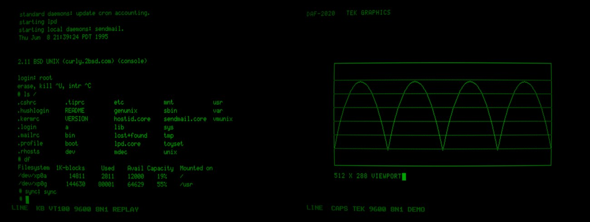

# Recif

[English](README.md)

<p align="center"></p>

Emulator al minicalculatoarelor românești CORAL de 16 biți și al terminalului
FEPER DAF-2020, sub forma a două programe legate printr-o linie serială.
Recif se compilează pentru Windows și pentru Linux, pe x64 și pe ARM64;
variantele ARM64 nu au fost încercate pe echipament ARM real (vezi
[notele de compatibilitate](docs/NOTES.ro.md#compatibilitate)).



## Calculatoarele

- `recif` este calculatorul: panoul unității centrale și instrumentul de
  linie de comandă. Se alege CORAL 4001, 4011, 4021 sau 4030 și se
  configurează memoria RAM, procesorul de virgulă mobilă FP11, portul serial,
  ceasul, banda magnetică și pachetele de discuri.
- `daf2020` este terminalul cu fosfor verde, cu modurile de lucru
  Tektronix 4010 și VT100.

Profilurile CORAL cuprind echipamentul documentat și rulează pe nuclee de
compatibilitate DEC numite explicit. Vezi
[modelele și sursele lor](docs/NOTES.ro.md#modelele-coral). Arhivele de
distribuție conțin un [pachet 2.11BSD](docs/NOTES.ro.md#211bsd) gata de
pornire.

## Pornire rapidă

1. Se extrage arhiva: `Recif-<versiune>-windows-x64.zip` sau
   `-windows-arm64.zip`, ori `Recif-<versiune>-linux-x64.tar.gz` sau
   `-linux-arm64.tar.gz`.
2. Se rulează `recif.exe` și `daf2020.exe` (Windows) sau `./recif` și
   `./daf2020` (Linux) din folderul extras.
3. În Recif se apasă **Pornire**: CORAL 4021 încarcă 2.11BSD, iar terminalul
   arată promptul `:`. Acolo se apasă Enter și se urmează
   [notele despre 2.11BSD](docs/NOTES.ro.md#211bsd).

Folderul conține cele două programe, `disks/` (pachetul 2.11BSD) și `docs/`.
Ambele programe își păstrează setările în `recif.yaml` și `daf2020.yaml`,
lângă programe.

Pe Linux sunt necesare un sistem pe 64 de biți cu glibc 2.34 sau mai nou și
bibliotecile cu care lucrează SDL: X11 sau Wayland, OpenGL sau OpenGL ES și,
pentru sunetul terminalului, ALSA sau PulseAudio. Panoul de pe Linux se
folosește cu mausul sau cu tastatura: Sus și Jos aleg rândul, Enter îl
modifică.

Cele două programe se pot porni și din linia de comandă. Exemplele din note
sunt scrise pentru PowerShell; pe Linux programele sunt `./recif` și
`./daf2020`, iar căile folosesc `/`.

```powershell
.\recif.exe run --model 4030 --serial tcp-listen:2323
.\daf2020.exe --serial tcp:127.0.0.1:2323
```

`recif --help` arată conversia benzilor, extragerea Files-11, restaurarea
discurilor și celelalte opțiuni de linie de comandă.

## Taste

În terminal:

| Tastă | |
|---|---|
| F12 | Deschide și închide setările: limba, modul de lucru, legătura serială, cele 14 comutatoare ale tastaturii, efectul CRT, ecranul inversat și repornirea |
| Ctrl+F12 | Oprește și pornește terminalul |
| Alt+F12 | Reinițializează terminalul |
| Shift+F12 | Ieșire |
| Alt+Enter | Ecran complet |
| Print Screen | Salvează `daf2020-NNNN.png` |
| F1 până la F4 | PF1 până la PF4 |
| F5, F6, F7 | PAGE, RESET, LF |
| F8 sau Pause | BREAK |
| F9 sau Scroll Lock | SCRL |

Orice altă tastă este tasta terminalului din același loc.
[Notele](docs/NOTES.ro.md#terminalul-daf-2020) descriu modurile de lucru și
comutatoarele terminalului.

## Limbi

Ambele programe sunt în engleză sau în română. Urmează limba sistemului până
se alege una în lista **Limbă** din panou sau în setările **F12** ale
terminalului. Acest README există și în [engleză](README.md).

## Documentație

- [Note](docs/NOTES.ro.md), și în [engleză](docs/NOTES.md): modelele CORAL,
  [pachetele de discuri](docs/NOTES.ro.md#pachete-de-discuri), 2.11BSD,
  terminalul, [legăturile seriale](docs/NOTES.ro.md#legături-seriale) (și cu
  ZetRo și MezinXT), imaginile de bandă și compatibilitatea.
- [Istoricul versiunilor](docs/CHANGELOG.md) (în engleză).
- [Componente terțe](docs/THIRD_PARTY.md) (în engleză), cu notele SDL și
  2.11BSD.

## Compilare din sursă

Pe Windows sunt necesare Visual Studio 2022 sau mai nou cu uneltele C++,
CMake 3.24 sau mai nou, Ninja, Python 3 și PowerShell 7. SDL se descarcă la
prima compilare.

```
pwsh -File tools/build.ps1
```

compilează `build/x64/recif.exe` și `build/x64/daf2020.exe` și rulează
testele. `pwsh -File tools/build.ps1 -Arch arm64` compilează pentru Windows pe
ARM când sunt instalate uneltele C++ ARM64 din Visual Studio; `-CoreOnly`
compilează linia de comandă a calculatorului fără SDL.
`pwsh -File tools/build_dist.ps1` face arhivele de distribuție în
`dist/releases/`; construiește pachetul 2.11BSD de pe banda lui de
distribuție cu `tools/unix211.py` și arhivele pentru Linux în WSL.

Pe Linux (Debian 12, inclusiv în WSL), `tools/build_linux.sh` compilează,
testează și împachetează programele x64 și ARM64; începutul lui enumeră
pachetele necesare.

## Licență

GPL-3.0-or-later (`docs/LICENSE`). Componentele terțe sunt listate în `docs/THIRD_PARTY.md`.
